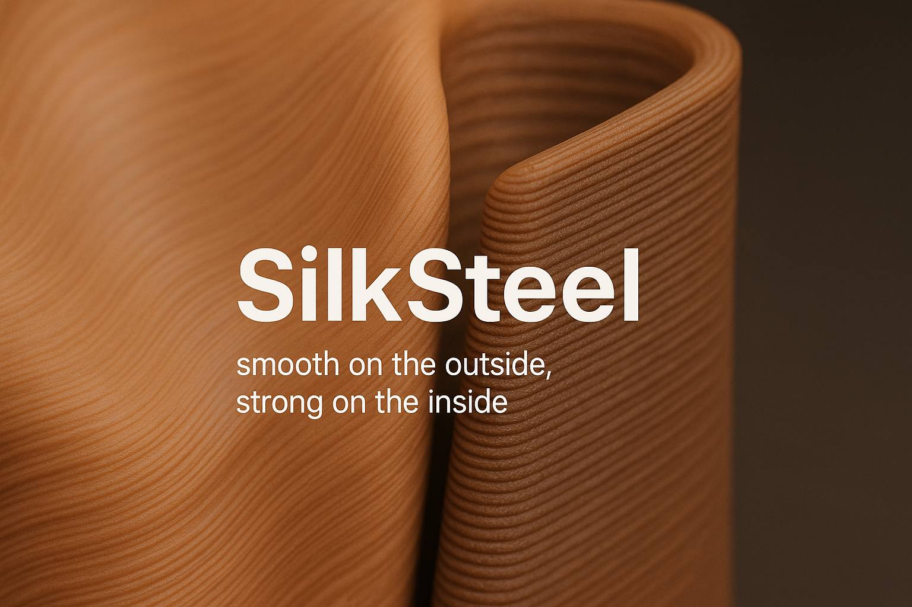
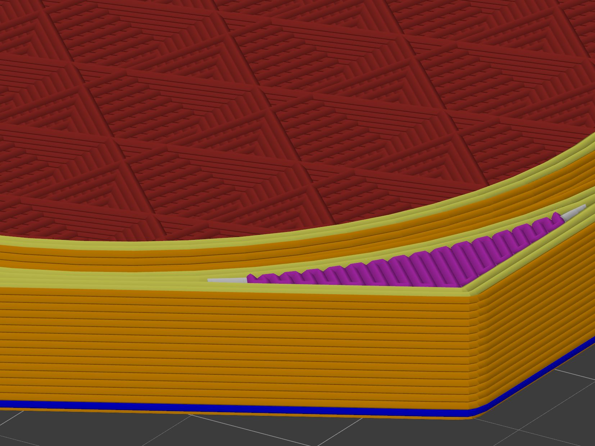
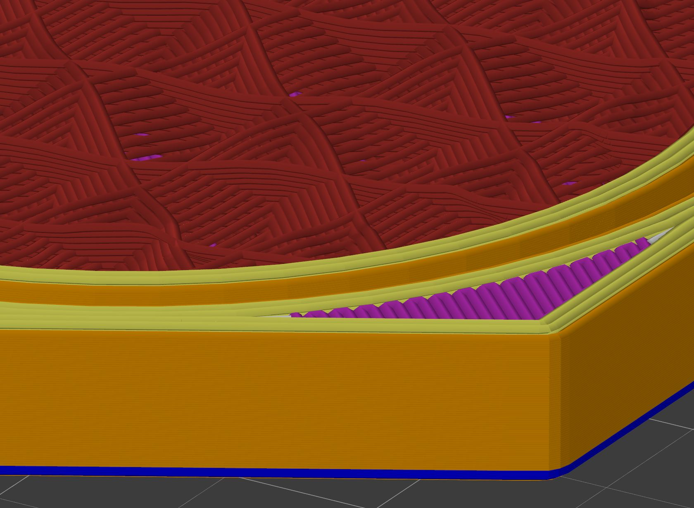
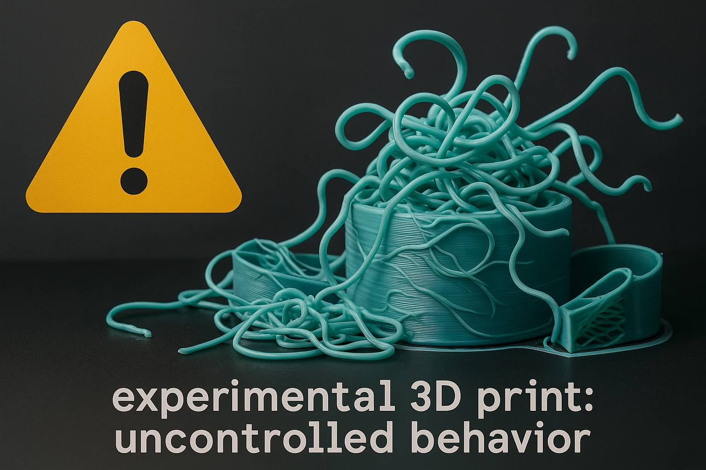
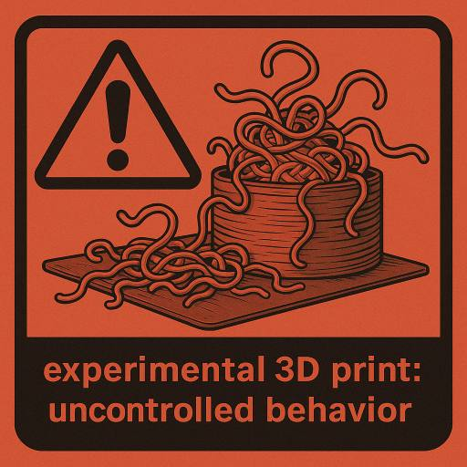

# SilkSteel G-Code Post-Processor [](https://www.paypal.com/donate/?hosted_button_id=VT4P4AT8FTYDL)

**SilkSteel** — *Smooth on the outside, strong on the inside.*

A powerful G-code post-processor that transforms your 3D prints by creating silk-smooth exterior surfaces while building steel-strong internal structures through intelligent layer manipulation.

---

## 🔎 Interactive 3D extrusion preview (`-preview`)

Open a local browser-based **volume** viewer automatically after post-processing:

```powershell
python SilkSteel.py input.gcode -full -o output.gcode -preview
```

The separate `silksteel_preview.py` module streams the processed G-code into compact binary data. Each deposited path is rendered as a **real 3D rounded rectangle** with corner radius `0.4 × min(width, height)`. It remains rounded-rectangular when free extrusion becomes taller than it is wide. The top follows the nozzle's programmed Z exactly; only the bottom stretches downward. The material area remains tied to `ΔE`, filament diameter and path length, not cosmetic line width. Colored materials distinguish Smoothificator, Bricklayers base/shifted, non-planar infill, valley filling and bridges.

The viewer has a **vertical layer selector on the right edge** and a **full-width playback dock at the bottom**. Toggle the timeline between **Gesamter Druck** (entire print, with layer-boundary ticks and visible layer labels) and **Aktueller Layer** (fine-grained scrubbing and replay scoped to one layer). Play/pause, playback speed, and a reset-to-range-start button work in both modes. The 3D deposition grows continuously within each G1 move. The Z-hop visibility/color control is located under **Extrusionstypen** rather than **Darstellung**. The sidebar defaults to **current layer plus the layer immediately below** (adjustable). Browsing layers with the right-hand slider, its +/- buttons, or timeline layer markers always shows the **fully completed selected layer** independent of playback time; scrubbing/playing resumes the normal temporal preview. The sidebar controls ghosted lower layers and feature visibility. **SilkSteel Safe Z-hops appear as red lift/travel/drop overlays**. When using `-o`, the model selector can switch between original and processed G-code.

Each feature (including the Z-hop overlay, initially red) now has a clickable color swatch. Colors change instantly without modifying the physical extrusion thickness; they persist through the local preview backend at `%LOCALAPPDATA%\\SilkSteel\\preview-colors.json` on Windows (or `~/.config/SilkSteel/preview-colors.json` on other systems), so they survive the random localhost ports used for each new viewer. A reset button restores the defaults. Browser localStorage is retained as a same-origin fallback.

Playback duration is estimated from commanded G-code feedrates and G4 dwell commands. Firmware acceleration/jerk, thermal waits and other machine-specific delays are not modelled, so elapsed time is an approximation rather than a slicer-accurate print-time estimate.

The preview window opens **immediately** after post-processing; large G-code files are converted asynchronously, with a progress indicator in the browser. If the detached browser launcher fails, inspect `SilkSteel_preview_log.txt` alongside `SilkSteel.py`, or run `python silksteel_preview.py output.gcode` directly to see any traceback and localhost URL.

**SuperSlicer compatibility:** `-preview` preserves an untouched original G-code **before** SilkSteel modifies the input and snapshots the processed result before the slicer deletes its temporary `*.gcode.pp` output. Thus original-versus-processed comparison also works when the postprocessor overwrites SuperSlicer's temporary input without `-o`. The snapshot is cleaned up when the viewer shuts down. The viewer also supports dropping `.gcode` / `.gcode.pp` onto the window or clicking **G-Code-Datei öffnen**; new files are analysed locally without running SilkSteel again. For a standalone empty viewer, run `python silksteel_preview.py` (no input required). It uses a temporary localhost server, which closes after the viewer has been inactive. Three.js is loaded from a version-pinned CDN, so a browser connection to the CDN is required.

**Analytical bead profiles (no occupancy raster):** The viewer renders the G-code's programmed material deposit, not a simulated nozzle collision with older lines. Ordinary extrusions use the nominal layer thickness and the commanded Z offset from the slicer layer reference. Smoothificator uses the explicitly emitted per-pass thickness; Bricklayers uses the base/shifted pass markers; valley filling uses the emitted small-Z-increment passes. A bridge receives a rounded, free-strand profile without querying support. Every path section preserves the physical extrusion volume, with the top surface following G-code Z and `A = width × height − (4 − π) × (0.4 × min(width,height))²`. No XY surface map is built, no 0.4-mm cells are probed, and a G1 is no longer subdivided purely to guess substrate contact. This intentionally idealized visual representation is **not** a prediction of sagging, overhang collisions, substrate contact, melt flow or temperature; it never changes printer G-code.

**Additional diagnostic tools:**

- **Continuous GPU loft (default):** Connected segments of the same extrusion feature share volume-averaged, identical profile rings at their junctions even when neighboring G1 widths/heights differ; the profile ring is stretched by the exact diagonal-cut factor 1/cos(turn/2). When that miter would extend beyond 45% of either adjacent segment, a local rounded sweep of profile rings connects the corner (including U-turns), rather than generating a spike or gap. Rounded G-code endpoints within 0.012 mm are snapped. Only actual path starts and ends receive separately instanced closed caps; the advancing print tip stays closed during playback. There is no CPU-built `LoftGeometry` mesh per G1 and no compute shader requirement. Extrusion mantles are GPU-instanced, spatially batched in 40-mm cells with up to 6,000 sections per batch and have conservative bounding spheres for camera frustum culling. Zoom-based profile LOD uses 2/4/7 corner subdivisions per quarter arc with hysteresis and reuses the same GPU instance attributes. Turning off **GPU-Loft (nahtlos)** switches to independent closed segments for debugging. Continuous extrusion moves (including reversals) stay connected; genuine travel breaks remain separate.
- **Interactive cross-section:** Enable **Schnittansicht**, select X, Y or Z, and scrub the position slider. Three.js clips the 3D volume and a bounded analytic pass traces intersected bead outlines. The contours are a geometric approximation, not manifold boolean cut caps; processing pauses during animation to preserve playback performance.
- **Automatic diagnostics:** The optional **Diagnose** panel flags extreme widths, abrupt extrusion Z excursions, potentially unsupported stretched extrusions, sudden neighboring flow changes and likely in-place Z-hops. Click a finding to seek its timestamp and focus the camera. Findings are heuristic warnings, not validated printer collisions.
- **Original / SilkSteel difference:** With two loaded G-codes, **Differenzansicht** draws original centerline tracks in cyan and shows spatial material differences in green (added) and red (reduced). Per-layer material totals are computed from bead volume; the location heatmap uses approximate 0.65-mm XY and 0.20-mm Z bins, not exact CSG subtraction. Comparison work is bounded to the active layer and deferred while playing.

**Plain slicer G-code compatibility:** Standard G0/G1 extrusion moves and G2/G3 arc-fitting commands are rendered, including relative/absolute extrusion, signed-radius arcs and absolute/relative arc-center modes. If a local bead cross-section is out of the admissible range, the valid neighboring portions are kept and the affected original movement is identified in diagnostics. **SilkSteel is not required** for the standalone viewer.

**G-code inspector and source verification:** Click a deposited track to open the exact numbered G-code line with nearby commands. The inspector highlights **the current played source line** in amber and the **manually selected source line** in blue (both independently, including travel moves and G4 dwell). Pinned indicators keep both source lines visible even when they are outside the scrolling context. The line-number field can jump directly to a timed G-code position. Under **Diagnose → G-Code-Rohbahnen prüfen**, the optional overlay shows extrusions that were skipped in the 3D reconstruction (red), G2/G3 arc endpoints represented by straight reference chords (pink), and Z-only extrusions (purple). Enable **Auch gerenderte Rohbahnen** to overlay *all* G-code positive-E tracks in cyan and directly compare the source paths with the volume renderer. This makes it possible to distinguish a missing G-code move from a preview reconstruction bug. The G-code is not loaded as a huge text blob: only a small numbered source window is read on demand using sparse offsets.

**Collapsible sidebar:** All eight left-hand sections are independently collapsible and their open/closed states persist across launches in `%LOCALAPPDATA%\\SilkSteel\\preview-sidebar.json` (Windows).

**Regression coverage:** `python -m unittest discover -s tests -v` checks the G-code parser and module integration, and `node tests/preview_modules.test.mjs` exercises join continuity, diagnostic heuristics, comparative volumes and clip contours. Both commands are included in the manually triggered GitHub Actions tests workflow.

**Accuracy limits:** This is a geometric approximation, not a thermal/material-flow simulation. Support is inferred from already printed paths at approximately 0.4 mm XY resolution; sparse or partially supported strands and print deformation are approximated, and real sagging, swelling, nozzle pressure and cooling are not simulated. G2/G3 arcs in G17/G18/G19 planes (I/J/K, signed R and helical moves) are tessellated into continuous, volume-preserving extrusion segments. Unsupported/malformed arcs are explicitly counted and shown as marked straight-line approximations where endpoints exist, never silently dropped. Avoid relying on the preview as the only safety check for printing.

---

## 🎯 What is SilkSteel?

SilkSteel is an advanced G-code post-processing tool developed by [48DESIGN](https://www.48design.de) that applies multiple optimization techniques to your sliced files:

- **Smoothificator**: Splits thick external perimeters into multiple ultra-thin passes for glass-smooth surfaces
- **Bricklayers**: Z-shifts alternating internal perimeters to create interlocking "brick pattern" for superior layer adhesion
- **Non-planar Infill**: Modulates Z height during infill printing to mechanically interlock with adjacent layers
- **Valley Filling**: Intelligently fills gaps between infill layers to prevent air pockets and improve strength
- **Safe Z-hop**: Intelligently lifts the nozzle during travel moves to prevent collisions with already-printed geometry
- **Bridge Densifier**: Adds parallel lines to bridges for improved strength and surface quality
- **Gap Fill Removal**: Optionally removes gap fill sections to reduce print time and potential artifacts

The result? Prints with **silk-smooth exteriors** and **steel-strong interiors**.




---


> [!WARNING]
> **⚠️ EXPERIMENTAL SOFTWARE ⚠️**
> 
> This tool is currently in an experimental state and has **not been extensively tested** across all printer configurations, slicers, and G-code variations. While it has shown promising results, you should:
> - **Always preview** the processed G-code in a viewer before printing
> - **Start with small test prints** to validate behavior on your specific setup
> - **Monitor your first prints** closely for any unexpected behavior
> - **Use at your own risk** - we are not responsible for failed prints or hardware damage
> 
> Please report any issues or unexpected behavior on our [GitHub Issues](https://github.com/48design/silksteel-gcode/issues) page to help improve the tool!

---

## ✨ Features

### 🧵 Smoothificator (Enabled by Default)
Creates ultra-smooth external surfaces by splitting thick perimeter walls into multiple thin passes:
- Converts single thick wall (e.g., 0.4mm) into 2-3 ultra-thin passes (e.g., 0.15mm each)
- Each pass is printed at a lower Z height, building up gradually
- Smoothing the outside without the need to raise the printing times of the whole print
- Eliminates visible layer lines on vertical surfaces
- Perfect for aesthetic parts, mechanical surfaces, and light-diffusing prints

**Best for:** Visible surfaces, vases, enclosures, decorative parts

### 🧱 Bricklayers (Optional, `-enableBricklayers`)
Strengthens parts by creating a brick-like interlocking pattern with internal perimeters:
- **First layer of internal perimiters**: All perimeter blocks printed in 2 passes at 0.75h each (total 1.5h)
- **Internal perimiters above**: Perimiters are Z-shifted by +0.5h (shifted) or printed normally (base) if solid surface above
- Creates mechanical interlocking between layers
- Can dramatically improve layer adhesion and structural strength
- Properly handles E values and travel moves to prevent artifacts

**Best for:** Functional parts, mechanical components, parts under stress

### 🌊 Non-planar Infill (Optional, `-enableNonPlanar`)
Modulates Z height during infill printing to create 3D wave patterns:
- Infill lines undulate up and down, creating mechanical anchors
- Automatically detects solid layers above/below and respects safe Z boundaries
- Pre-calculates 3D occupancy grid to prevent nozzle collisions
- Two pattern modes: sine waves or Perlin noise
- Compensates extrusion using the true XYZ length of each Z-modulated segment (upward and downward, after Z clamping)
- Preserves the slicer's extrusion amount for horizontal segments; optional adaptive safezone extrusion remains additional
- Significantly improves infill-to-perimeter bonding

**Best for:** Large flat surfaces, parts with sparse infill, structural components

### 🏔️ Valley Filling (Automatic with Non-planar Infill)
Intelligently fills the gaps (valleys) created by non-planar infill:
- Detects when infill dips below the current layer height
- Automatically fills valleys with multiple passes, building back up to layer height
- Creates gaps at infill crossing points to prevent over-extrusion
- Only the last crossing gets filled to minimize collisions
- Uses 50% extrusion rate for gradual valley filling
- Dramatically improves strength by eliminating air pockets between layers

**Best for:** Automatically enabled with non-planar infill - no configuration needed!

### 🛡️ Safe Z-hop (Enabled by Default)
Prevents nozzle collisions during travel moves:
- Pre-calculates maximum Z height per layer
- Lifts nozzle to `max_z + margin` before travel moves
- Only activates after first layer to avoid startup issues
- Configurable safety margin (default: 0.5mm)
- Essential when using Bricklayers or Non-planar features

Notes and heuristics:
- The Z-hop logic samples the same non-planar LUT used by the infill to compute an accurate maximum Z along each travel path and adds the configured margin.
- The processor will never insert a lift during bridge infill sections or wipe sequences (it recognizes `;TYPE:Bridge infill` and `;WIPE` markers). However, drops (lowering back to printing height) are still inserted before the next extrusion so the nozzle never prints mid-air.
- To exclude particular wipe/comment conventions from suppression, you can edit the script or add explicit `;WIPE_START` / `;WIPE_END` markers in slicer post-processing.

**Best for:** All prints, especially with Z-shifting features enabled

### 🌉 Bridge Densifier (Experimental, `-full` oder `-enableBridgeDensifier`)
Densifies validated bridge raster gaps using **continuous serpentine toolpaths** rather than printing extra strands after the fact and returning with long travel moves.

- Matches consecutive, reverse-parallel bridge spans with short U-turns between them.
- Adds as many interior strands as warranted by the measured gap, up to a conservative limit.
- Plans the **whole connected raster** as a zigzag to minimize redundant full-length returns.
- Preserves source extrusion/retractions and restores the slicer's absolute E position where needed; handles M82 and M83.
- Leaves unknown geometry, standalone strokes and unsupported motion patterns unchanged.
- Processes **only** `;TYPE:Bridge infill`; `;TYPE:Internal bridge infill` is excluded from densification.

**Example:**
```bash
python SilkSteel.py input.gcode -o bridge_test.gcode -enableBridgeDensifier
```

**Caution:** Still experimental and **enabled by `-full`** (disable with `-disableBridgeDensifier`). Additional bridge extrusion changes the amount of deposited material. Inspect modified Bridge infill regions in a G-code viewer and validate with a short test print.

### 🔧 Gap Fill Removal (Optional, `-enableRemoveGapFill`)
Removes gap fill sections from G-code:
- Detects and removes ";TYPE:Gap fill" sections
- Can reduce print time by skipping thin gap-filling passes
- May improve surface quality by eliminating potential artifacts from gap fill
- Useful when gap fill causes problems or isn't needed
- Position tracking maintained even when gap fill is removed

**Best for:** Prints where gap fill causes artifacts or isn't structurally necessary

**Note:** Gap fill is often useful for sealing small gaps. Only remove it if you're experiencing issues or want faster prints.

---

## 📦 Installation

### Requirements
- Python 3.7+
- NumPy (for non-planar noise generation)
 - Pillow (optional) — required only for visualization (`-debug-full`) and PNG generation

### Setup
```bash
# Clone or download this repository
git clone https://github.com/48design/silksteel-gcode.git
cd silksteel-gcode

# Install dependencies
pip install numpy
# Optional: install Pillow for visualization features
pip install pillow
```

---

## 🚀 Usage

### Basic Usage (Smoothificator only)
```bash
python SilkSteel.py input.gcode -o output.gcode
```

### Enable Stable Processing Features
```bash
python SilkSteel.py input.gcode -o output.gcode -full
```

### Custom Feature Combinations
```bash
# Smoothificator + Bricklayers only
python SilkSteel.py input.gcode -o output.gcode -enableBricklayers

# All features with custom settings
python SilkSteel.py input.gcode -o output.gcode -full -amplitude 1.5 -frequency 8

# Full mode but disable Bridge Densifier
python SilkSteel.py input.gcode -o output.gcode -full -disableBridgeDensifier

# Enable Bridge Densifier without -full
python SilkSteel.py input.gcode -o output.gcode -enableBridgeDensifier

# Bricklayers with reduced extrusion on shifted blocks
python SilkSteel.py input.gcode -o output.gcode -enableBricklayers -bricklayersExtrusion 0.9
```

### In-Place Mode (For Slicer Integration)
```bash
# Modifies the input file directly (required for slicer post-processing scripts, gcode automagically 🧙 added by slider)
"{fielpath-to-your-python.exe}" "{path-to-silksteel}\SilkSteel.py" -full
```

---

## 🛠️ Command-Line Options

### Input/Output
```
input_file              Input G-code file (required)
-o, --output           Output file (if omitted, modifies input file in-place)
```

### Feature Toggles
```
-full, --enable-all                Enable Bricklayers, Non-planar Infill and Bridge Densifier;
                                   Gap Fill Removal remains opt-in.
-enableBricklayers                 Enable Bricklayers Z-shifting (default: disabled)
-disableBricklayers                Disable Bricklayers (overrides -full)
-enableNonPlanar                   Enable non-planar infill (default: disabled)
-disableNonPlanar                  Disable non-planar infill (overrides -full)
-enableBridgeDensifier             Enable Bridge Densifier (default: disabled without -full)
-disableBridgeDensifier            Disable bridge densifier (overrides -full)
-enableRemoveGapFill               Enable gap fill removal (default: disabled)
-disableRemoveGapFill              Disable gap fill removal (overrides -full)
-disableSmoothificator             Disable Smoothificator (default: enabled)
-disableSafeZHop                   Disable safe Z-hop (default: enabled)
```

### Smoothificator Settings
```
-outerLayerHeight MODE|FLOAT       Height for outer wall passes:
                                   "Auto" = min(first_layer, base_layer) * 0.5 (default)
                                   "Min" = uses min_layer_height from G-code
                                   FLOAT = explicit value in mm (e.g., 0.1)
                                   
                                   Examples:
                                   -outerLayerHeight Auto    → Smart default
                                   -outerLayerHeight Min     → Ultra-fine (slow)
                                   -outerLayerHeight 0.12    → Manual control
```

### Bricklayers Settings
```
-bricklayersExtrusion FLOAT        Extrusion multiplier for shifted blocks
                                   (default: 1.0, try 0.9-1.1 for tuning)
```

### Non-planar Infill Settings
```
-deformType {sine,noise}           Pattern type (default: sine)
                                   sine: smooth wave patterns
                                   noise: Perlin noise for organic variation
-segmentLength FLOAT               Line subdivision length in mm (default: 0.64)
-amplitude INT|FLOAT               Z modulation amplitude (default: 4)
                                   INT = number of layer heights (e.g., 4 → 4 layers)
                                   FLOAT = explicit value in mm (e.g., 2.5 → 2.5mm)
                                   Higher = more pronounced waves
-frequency FLOAT                   Pattern frequency (default: 8)
                                   Higher = tighter waves
-nonplanarFeedrateMultiplier FLOAT Feedrate boost for non-planar moves (default: 1.1x)
-disableAdaptiveExtrusion          Disable adaptive extrusion (default: enabled)
-adaptiveExtrusionMultiplier FLOAT Extrusion boost per layer of Z-lift (default: 1.5x)
                                   Controls extra material for bonding when lifting
                                   Example: 1 layer lift = 1.5x extrusion
                                            2 layer lift = 3.0x extrusion
```

### Safe Z-hop Settings
```
-safeZHopMargin FLOAT              Safety margin above max Z in mm (default: 0.5)
```

### Bridge Densifier Settings
```
-bridgeMinLength FLOAT             Minimum bridge line length to densify in mm (default: 2.0)
-bridgeMaxSpacing FLOAT            Maximum spacing between parallel bridge lines in mm (default: 0.9)
-bridgeConnectorMaxLength FLOAT    Maximum connector length before using travel move in mm (default: 5.0)
```

### Debug Options
```
-debug                             Enable basic debug mode: console output only
-debug-full                        Enable full debug mode: console output + 
                                   visualization files (3D grid G-code + PNG images)
                                   
                                   Generates:
                                   - grid_visualization.gcode: 3D wireframe showing
                                     detected solid cells and cross-sections
                                   - layer_XXX_zYY.YY.png: Per-layer images showing
                                     solid occupancy grid (white = solid, black = air)
                                   - SilkSteel_log.txt: Detailed processing log
```

---

## 📋 Workflow & Best Practices

### Slicer Settings
1. **Slice your model normally** with your preferred settings
2. Use **variable layer heights** if desired (SilkSteel handles them correctly)
3. For Smoothificator: Set external perimeter extrusion width to 0.4-0.5mm
4. For Bricklayers: Enable at least 2 perimeters
5. For Non-planar: Use 20-50% infill with rectilinear or grid pattern (others work, too)
6. For Bridge Densifier: Enable "Detect bridging perimeters" in slicer (usually default)
7. Make sure that your slicer uses comments for layer changes and extrusion types (shoild be enabled by default)

### Recommended Feature Combinations

**Display Parts (Focus: Appearance)**
```bash
python SilkSteel.py model.gcode -o output.gcode
# Smoothificator only - perfect surface finish
```

**Functional Parts (Focus: Strength)**
```bash
python SilkSteel.py model.gcode -o output.gcode -enableBricklayers
# Smoothificator + Bricklayers - strong and smooth
```

**Large Structural Parts (Focus: Maximum Strength)**
```bash
python SilkSteel.py model.gcode -o output.gcode -full
# All features - ultimate strength with good finish
```

### Processing Time
- Small prints (< 50 layers): < 5 seconds
- Medium prints (50-200 layers): 10-30 seconds  
- Large prints (200+ layers): 30-90 seconds
- Non-planar infill adds 20-50% processing time due to 3D grid calculations

---

## 🔧 Integration with Slicers

### PrusaSlicer / SuperSlicer
1. Go to: **Print Settings → Output options → Post-processing scripts**
2. Add: `python "C:\path\to\SilkSteel.py"`
3. The script will modify the G-code file in-place after slicing

### Cura
1. Go to: **Extensions → Post Processing → Modify G-Code**
2. Add script: **Run a script after slicing**
3. Set path: `python "C:\path\to\SilkSteel.py" "[output_file]"`

### OrcaSlicer
1. Go to: **Printer Settings → Machine G-code → Post-process script**
2. Add: `python "C:\path\to\SilkSteel.py"`

---

## 📊 Technical Details

### How Smoothificator Works
1. Detects external perimeter blocks via TYPE comments
2. Determines target layer height:
   - **Auto mode** (default): Uses `min(first_layer_height, base_layer_height) * 0.5`
   - **Min mode**: Uses `min_layer_height` from adaptive layer settings
   - **Manual**: Uses specified float value
3. Calculates number of passes needed based on outer_layer_height
4. Splits perimeter into multiple passes, each at incrementing Z
5. Adjusts extrusion per pass to maintain proper wall thickness
6. Handles wipe moves and travel moves correctly

### How Bricklayers Works
1. Detects internal perimeter blocks
2. On layer 0: All blocks printed in 2 passes (0.75h + 0.75h)
3. On layer 1+: Alternates between shifted (+0.5h) and base (normal Z)
4. Uses G92 E0 resets to maintain proper E value tracking
5. Reduces extrusion to 0.5x on shifted blocks of the last layer (to end flat)

### How Non-planar Infill Works
1. **Pass 1: Build 3D Occupancy Grid**
   - Scans entire G-code to detect all solid layers (perimeters, solid infill, bridges)
   - Tracks extrusion moves (G1 with E parameter) within solid TYPE sections
   - Detects retractions (E < 0.01) to break continuity across travel moves
   - Uses DDA algorithm to mark all grid cells (default: 0.5mm resolution) along extrusion paths
   - Creates accurate 3D map of where solid material exists

2. **Pass 2: Calculate Safe Z Ranges**
   - For each XY grid cell, analyzes solid layers above and below
   - Calculates safe Z ranges (gaps between solid layers)
   - Stores min/max safe Z per grid cell to prevent collisions

3. **Pass 3: Process Infill with Z Modulation & Valley Filling**
   - Subdivides infill lines into small segments
   - Applies sine wave or Perlin noise pattern to calculate target Z
   - Clamps Z values to safe range for each grid cell
   - **Valley Detection**: When Z drops below layer height, enters valley mode
   - **Valley Filling**: Collects all segments in valley, then fills with multiple passes
   - **Crossing Detection**: Skips valley fill at infill crossing points (except last one)
   - **Smart Gaps**: Creates gaps where infill lines cross to prevent collisions
   - **Crossing Countdown**: Decrements crossing count after each valley passes through
   - Updates E values proportionally to actual 3D line length
   - Boosts feedrate for non-planar moves

4. **Collision Avoidance**
   - Constantly checks grid to ensure nozzle stays in safe Z range
   - Prevents crashes into already-printed perimeters or solid layers
   - Handles variable layer heights and complex geometries

### Grid Resolution & Accuracy
- Default: **0.5mm** grid cells (configurable via `GRID_RESOLUTION` constant)
- Finer grid = more accurate collision detection, slower processing
- Coarser grid = faster processing, less precise safe zones
- Uses floor division for consistent cell assignment
- DDA line-drawing algorithm ensures no cells are skipped

### How Safe Z-hop Works
1. Pre-calculates maximum Z per layer during first scan pass
2. Before each travel move (G1 with X/Y but no E), lifts to max_z + margin
3. Only activates after first layer starts
4. Returns to normal Z after travel completes

### How Bridge Densifier Works
1. Detects bridge infill sections and buffers all bridge lines
2. Identifies parallel line pairs and creates edge lines offset perpendicular to bridge direction
3. For single isolated lines: creates 3 parallel copies (LEFT, MIDDLE, RIGHT)
4. Generates intermediate lines between paired lines when spacing allows
5. Connects all lines using serpentine path optimization (always choose closest endpoint)
6. Uses G0 travel for long connectors (>5mm), G1 extrusion for short connectors
7. Maintains proper E values throughout, minimizes E mode switching

---

## 🐛 Troubleshooting

### Issue: Rough surfaces after Smoothificator
**Solutions**: 
- Decrease outer_layer_height (try `-outerLayerHeight 0.1` or `0.12`)
- Use Auto mode (default) for balanced results
- Use Min mode (`-outerLayerHeight Min`) for ultra-smooth but slower prints

### Issue: First layer too thin/adhesion problems
**Solution**: 
- Use Auto mode (default) instead of Min mode
- Auto mode avoids splitting thin first layers into ultra-tiny passes
- Manual override: `-outerLayerHeight 0.15` for thicker passes

### Issue: Weak Bricklayers shifting
**Solution**: Increase bricklayers_extrusion multiplier to 1.05-1.1

### Issue: Non-planar infill colliding with walls
**Solution**: Reduce amplitude or check grid detection with `-debug-full` flag to visualize solid occupancy

### Issue: Valleys not filling properly / Air pockets in print
**Solution**: Valley filling is automatic with non-planar infill - ensure you're using `-enableNonPlanar` or `-full`

### Issue: Over-extrusion at infill crossings
**Solution**: This is now prevented by the crossing detection system - gaps are automatically created at crossing points except the last one

### Issue: Grid shows solid where there shouldn't be any
**Solution**: This was fixed - script now detects retractions (E < 0.01) and breaks tracking across travel moves

### Issue: Want to see what the grid looks like
**Solution**: Use `-debug-full` to generate PNG images and 3D grid visualization G-code

### Issue: Stringing or blobs on travels
**Solution**: Safe Z-hop should prevent this - check that it's enabled

### Issue: Bridges sagging or weak
**Solution**: Enable Bridge Densifier with `-enableBridgeDensifier` or `-full`. If still weak, adjust slicer bridge settings (speed, flow, fan)

### Issue: Over-extrusion on bridge edges
**Solution**: This is rare but can happen with very thin bridges - bridge densifier can be left disabled if needed

### Issue: Bridge processing taking too long
**Solution**: Increase `-bridgeMinLength` to skip short bridges

### Issue: First layer problems
**Solution**: Safe Z-hop intentionally skips first layer to avoid issues

### Issue: Print time significantly increased
**Solution**: Non-planar adds many small moves - reduce frequency or disable for faster prints

---

## 🙏 Credits & Acknowledgments

SilkSteel is developed and maintained by 48DESIGN GmbH (Fabian Groß).

Company:
- 48DESIGN GmbH
- Karlsruhe, Germany

Contact & Support:
- Website: https://www.48design.com
- Issues / Feature Requests: https://github.com/48design/silksteel-gcode/

Special thanks to Roman Tenger for the original concepts and inspiration:
- Smoothificator technique for multi-pass external perimeters
- Bricklayers Z-shifting concept for improved layer bonding
- Non-planar infill modulation for mechanical interlocking

SilkSteel represents a complete rewrite and optimization of these concepts, with significant enhancements:
- Proper E value tracking and G92 E0 resets for Bricklayers
- 3D occupancy grid system for safe non-planar infill
- Safe Z-hop collision avoidance
- Robust TYPE marker detection and travel move handling
- Performance optimizations for large files

---

## 📄 License

This program is free software: you can redistribute it and/or modify it under the terms of the GNU General Public License as published by the Free Software Foundation, either version 3 of the License, or (at your option) any later version.

This program is distributed in the hope that it will be useful, but WITHOUT ANY WARRANTY; without even the implied warranty of MERCHANTABILITY or FITNESS FOR A PARTICULAR PURPOSE. See the GNU General Public License for more details.

You should have received a copy of the GNU General Public License along with this program. If not, see <https://www.gnu.org/licenses/>.

**Copyright (c) [2025] [48DESIGN GmbH - Fabian Groß]**

---

## 🔗 Links & Resources

- GitHub Repository: [48design/silksteel-gcode]
- Issues & Feature Requests: [GitHub Issues]
- Original Smoothificator concept: [github.com/TengerTechnologies]

---

## 🌟 Contributing

Contributions are welcome! Please feel free to submit pull requests or open issues for bugs and feature requests.

---

**Made with ❤️ and 🧠 and 🤖 for the 3D printing community.**
If this project helps you creating even more awesome 3D prints and if you want to help us improve this and other tools, you can sponsor us a cup of :coffee: - or two! :)
[donate](https://www.48design.com/donate/)

---

